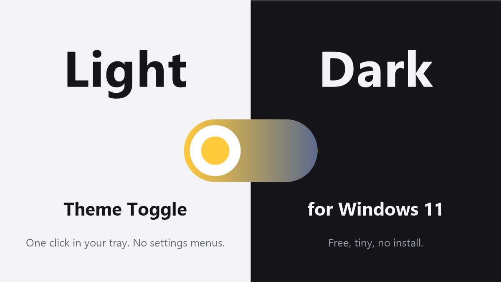

# Theme Toggle

A tiny Windows 11 tray app. Click the sun/moon icon to switch between light and dark mode (apps and system).



## Use

1. Download `ThemeToggle.exe` from the [latest release](../../releases/latest).
2. Run it. On first launch it asks whether to start with Windows.
3. Left-click the tray icon to toggle the theme. Right-click for "Schedule...", "Start with Windows" and Exit.

### Updates

The app checks this repo's latest GitHub release shortly after start and then daily. If a newer version exists it asks before downloading and replacing itself. Right-click the icon for "Check for updates now" or to turn the automatic check off. Only a request to the GitHub API is made; nothing about you is sent.

### Schedule

Right-click the icon, choose **Schedule...**, tick the box and pick the time for light mode and the time for dark mode. The app then switches by itself at those times (it must be running, so enable "Start with Windows"). A manual click still works and stays until the next scheduled switch. Times can span midnight, e.g. dark at 20:00 and light at 06:00.

`ThemeToggle.exe --toggle` switches once and exits, handy for shortcuts and scripts.

Windows 11 hides new tray icons in the `^` overflow menu; drag the icon onto the taskbar to keep it visible.

The exe is unsigned, so SmartScreen may warn on first run ("More info", then "Run anyway").

## Build

Needs nothing beyond Windows itself (uses the .NET Framework compiler that ships with it):

```
build.cmd
```

## Why not a Quick Settings tile?

Windows 11 does not let third-party apps add tiles to Quick Settings, so a tray icon is the closest option.

## License

MIT


